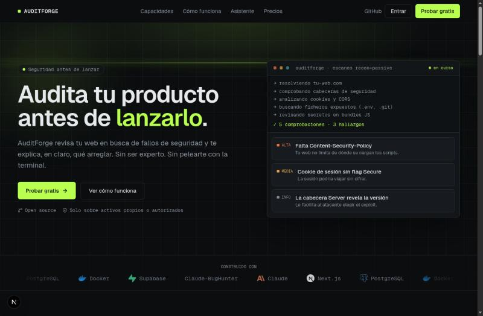
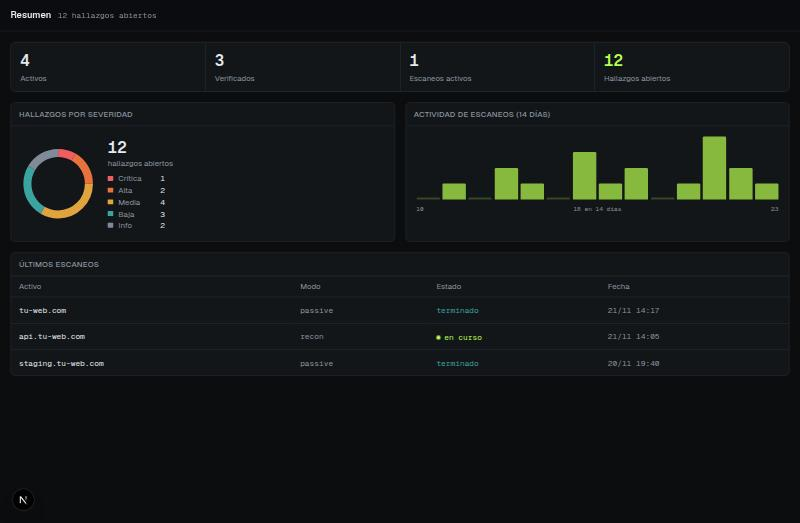

<div align="center">

# AuditForge

**Pre-launch security audits for your own products — in plain language.**

Point it at a site you own, verify ownership, and get recon/passive findings explained
by a Claude agent that orchestrates [Claude-BugHunter](https://github.com/elementalsouls/Claude-BugHunter).
Self-hosted. One command to deploy.

[](LICENSE)


[English](#english) · [Español](#español)



</div>

---

## English

AuditForge is a self-hosted security audit panel for **non-experts** who ship software and want
to check it before (and after) launch. The hard part of security tooling is that it lives in the
terminal and assumes you're a pentester. AuditForge puts that power behind a panel and translates
the results into something you can act on.

It is strictly scoped: it only audits **assets you've proven you own or are authorized to test.**
Not a tool for pointing at third parties.

### What it does

- **Passive recon, no setup.** HTTPS, security headers, cookies, CORS, exposed files (`.env`,
  `.git`), secrets in public JavaScript — the deterministic checks run in seconds, no API key needed.
- **AI that explains and prioritizes.** Add your own Claude API key and an agent investigates
  adaptively (scoped to your target), writes new findings, and tells you what to fix first — in plain
  language, not jargon.
- **Cost tiers.** Económico / Equilibrado / Máximo map to Haiku / Sonnet / Opus, per scan.
- **Scope-gated by design.** Three gates in the database — verified ownership, allowlist, allowed
  mode — enforced by signed tokens, not just the UI.
- **Findings, reports, live scan log.** Track status over time, export, watch scans as they run.



### Quick start

You need Docker (with `docker compose` v2) and `openssl`.

```bash
git clone https://github.com/nerdcuba/auditforge.git && cd auditforge
./scripts/install.sh
```

That generates every secret, builds, and brings up the whole stack (database, auth, panel,
worker) in one command — the same on your laptop or a VPS. Then create your first user:

```bash
./scripts/create-user.sh you@example.com
```

Open the panel at the URL the installer prints and read the magic-link email in the bundled
inbox (Mailpit). Full guide: **[DEPLOY.md](DEPLOY.md)**.

> On a VPS: `PUBLIC_HOST=audit.yourdomain.com PUBLIC_SCHEME=https ./scripts/install.sh`.
> Access the panel by the host you set, not `localhost`.

### How scope works

Every scan passes **three gates** before it runs, or it doesn't run:

1. **Ownership** — prove the asset is yours via a DNS TXT record or a file on the host.
2. **Allowlist** — an explicit opt-in, separate from verification.
3. **Mode** — `recon`/`passive` by default; `active` (intrusive) needs a per-asset opt-in and an
   isolated worker.

The worker verifies an EdDSA-signed scope token bound to the exact target before doing anything,
and its egress is meant to reach only that target. Treat it as a red zone (see
[`worker/README.md`](worker/README.md)).

### Built with

Next.js · Supabase (self-hosted: Postgres + GoTrue + PostgREST) · Docker · the Anthropic SDK ·
and [Claude-BugHunter](https://github.com/elementalsouls/Claude-BugHunter) as the engine's skill
library.

---

## Español

AuditForge es un panel de auditoría de seguridad **autohospedado** para **quien no es experto** y
quiere revisar su software antes (y después) de lanzarlo. Las herramientas de seguridad viven en la
terminal y asumen que eres pentester; AuditForge pone esa potencia detrás de un panel y te traduce
los resultados a algo accionable.

Alcance estricto: solo audita **activos cuya propiedad has verificado o tienes autorización para
probar.** No sirve para apuntar a terceros.

### Qué hace

- **Recon pasivo, sin configurar.** HTTPS, cabeceras de seguridad, cookies, CORS, ficheros
  expuestos (`.env`, `.git`), secretos en el JavaScript público — en segundos y sin clave.
- **IA que explica y prioriza.** Con tu propia clave de Claude, un agente investiga de forma
  adaptativa (acotado a tu objetivo), añade hallazgos y te dice qué arreglar primero, en claro.
- **Niveles de coste.** Económico / Equilibrado / Máximo → Haiku / Sonnet / Opus, por escaneo.
- **Alcance blindado por diseño.** Tres puertas en la base de datos (propiedad verificada,
  allowlist, modo permitido), impuestas con tokens firmados, no solo en la UI.
- **Hallazgos, reportes y log en vivo.** Sigue el estado, exporta, mira los escaneos en directo.

### Arranque rápido

Necesitas Docker (con `docker compose` v2) y `openssl`.

```bash
git clone https://github.com/nerdcuba/auditforge.git && cd auditforge
./scripts/install.sh
```

Genera todos los secretos, construye y levanta todo el stack en **un comando**, igual en tu PC que
en una VPS. Luego crea tu usuario con `./scripts/create-user.sh tu@correo.com` y abre el panel en la
URL que te imprima (el enlace mágico de acceso se ve en el buzón incluido, Mailpit). Guía completa:
**[DEPLOY.md](DEPLOY.md)**.

### Cómo funciona el alcance

Cada escaneo pasa **tres puertas** antes de ejecutarse: **propiedad** verificada (registro DNS TXT o
fichero en el host), **allowlist** (autorización explícita) y **modo** (`recon`/`passive` por
defecto; `active` intrusivo exige opt-in por activo y el worker aislado). El worker valida un token
de alcance firmado (EdDSA) atado al objetivo exacto antes de tocar nada.

---

## Roadmap

- [x] Recon/passive + motor determinista
- [x] Orquestador IA pasivo (tool-use, acotado al origen)
- [x] Despliegue todo-en-uno (self-host)
- [ ] Modo `active` con worker aislado + skills intrusivas de Claude-BugHunter
- [ ] Tier hosted (futuro)

## Credits · Créditos

Security engine based on **[Claude-BugHunter](https://github.com/elementalsouls/Claude-BugHunter)**
by Sachin Sharma (MIT · CC BY 4.0). See [`worker/NOTICE`](worker/NOTICE).

## License

[AGPL-3.0](LICENSE). Use it only on assets you own or are authorized to test.
